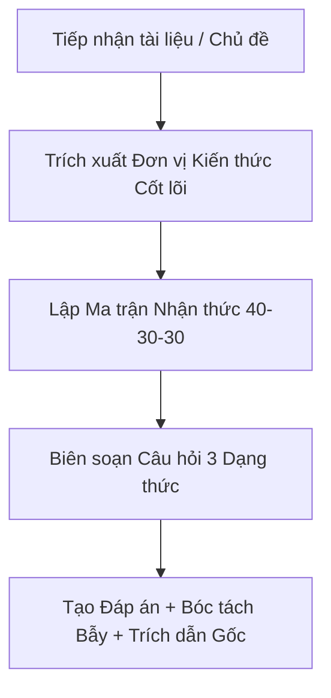

# KỸ NĂNG QUIZ-MASTER: TỰ ĐỘNG BIÊN SOẠN ĐỀ LUYỆN TẬP CHUẨN KHẢO THÍ

Kỹ năng này hướng dẫn Antigravity từng bước tiếp nhận tài liệu của người học, phân tích cấu trúc nội dung, thiết lập ma trận đề thi và xuất bản các bộ câu hỏi chất lượng cao theo chuẩn khảo thí hiện đại.

---

## 1. QUY TRÌNH THỰC THI 4 BƯỚC

### Bước 1: Tiếp nhận và Trích xuất Đơn vị Kiến thức (Knowledge Extraction)
1. Đọc kỹ tài liệu do người dùng tải lên hoặc dán vào cuộc trò chuyện.
2. Xác định các thực thể kiến thức cốt lõi:
   - Các định nghĩa, khái niệm hạt nhân.
   - Các công thức toán/lý/hóa/kinh tế, định lý, quy tắc vận hành.
   - Các mối quan hệ nguyên nhân - kết quả, các trường hợp ngoại lệ.
   - Các sự kiện, mốc thời gian, nhân vật hoặc dữ liệu then chốt.

### Bước 2: Xác định Ma trận Phân bổ Mức độ Nhận thức
Áp dụng ma trận mặc định nếu người dùng không yêu cầu số lượng câu cụ thể:
- **Tổng số câu**: 10 câu.
- **Tỷ lệ nhận thức**: 
  - 40% Nhận biết (4 câu tương đương)
  - 30% Thông hiểu (3 câu tương đương)
  - 30% Vận dụng & Vận dụng cao (3 câu tương đương)
- **Phân bổ dạng thức**:
  - **Phần I**: 5 câu Trắc nghiệm 4 lựa chọn (A, B, C, D).
  - **Phần II**: 1 câu Trắc nghiệm Đúng/Sai (dạng chùm gồm 4 ý a, b, c, d).
  - **Phần III**: 4 câu Trắc nghiệm Trả lời ngắn.

### Bước 3: Biên soạn Câu hỏi theo Kỹ thuật Khảo thí
- **Nhận biết**: Kiểm tra khả năng nhận diện thông tin chính xác trong bài.
- **Thông hiểu**: Diễn giải bằng từ ngữ khác, hỏi về nguyên nhân/ý nghĩa/bản chất.
- **Vận dụng**: Thiết kế tình huống thực tiễn mới hoặc bài toán đòi hỏi tính toán/suy luận nhiều bước.

> Chi tiết tham khảo:
> - [Thang đo nhận thức Bloom và Động từ hành vi](./references/bloom_cognitive_levels.md)
> - [Mẫu định dạng câu hỏi và Lời giải chuẩn](./references/question_templates.md)

### Bước 4: Hoàn thiện Lời giải và Phản hồi Tương tác
- Đóng gói Đề thi ở phần trên (rõ ràng, không để lộ đáp án).
- Đóng gói Bảng Đáp án và Hướng dẫn giải chi tiết ở phần dưới (sử dụng `
` để người dùng có thể chủ động ẩn/hiện khi tự làm bài).
- Mời người dùng nộp câu trả lời để được chấm điểm và phân tích điểm khuyết kiến thức nếu muốn làm bài tương tác.

---

## 2. CHẾ ĐỘ PHẢN HỒI NÂNG CAO (THEO YÊU CẦU NGƯỜI DÙNG)

Khi người học đưa ra các yêu cầu đặc thù, Antigravity chuyển đổi cách xử lý tương ứng:

1. **"Đố tôi từng câu một" / "Chế độ tương tác"**:
   - Gửi 1 câu hỏi duy nhất (bắt đầu từ câu 1).
   - Đợi người dùng phản hồi đáp án.
   - Chấm điểm ngay lập tức, giải thích chi tiết, rồi gửi tiếp câu thứ 2.
2. **"Tập trung câu hỏi khó / Vận dụng"**:
   - Chuyển toàn bộ ma trận sang 70% Vận dụng và 30% Vận dụng cao.
   - Đưa ra các bài toán thực tế, case study phức tạp.
3. **"Tóm tắt trước khi đố"**:
   - Cung cấp một bảng tổng hợp hoặc bullet points tóm tắt kiến thức cốt lõi của tài liệu trước khi xuất đề thi.

---

## 3. CHECKLIST KIỂM ĐỊNH CHẤT LƯỢNG TRƯỚC KHI XUẤT ĐỀ (SELF-EVALUATION CHECKLIST)

Trước khi gửi câu trả lời cho người dùng, Antigravity phải tự rà soát:
- [ ] Câu hỏi có thông tin nào bịa đặt nằm ngoài tài liệu không? (Không được bịa đặt).
- [ ] Các phương án A, B, C, D có độ dài xấp xỉ nhau không?
- [ ] Có phương án lười biếng "Tất cả đều đúng/sai" không? (Phải loại bỏ hoàn toàn).
- [ ] Mệnh đề Đúng/Sai có rõ ràng, không gây tranh cãi không?
- [ ] Câu trả lời ngắn có quy định rõ định dạng kết quả (làm tròn, đơn vị, từ khóa) không?
- [ ] Đã có trích dẫn minh chứng từ tài liệu trong phần giải thích chưa?
